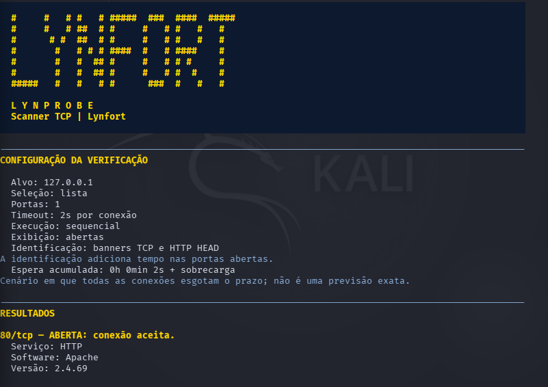

# LynProbe

**Lynfort | Scanner TCP em Python**



Scanner de portas TCP para terminal Linux, desenvolvido em Python com bibliotecas padrão. Recebe um endereço IPv4, verifica uma lista, portas comuns, um intervalo ou todas as portas TCP sequencialmente e pode salvar um relatório JSON. A identificação opcional reconhece respostas HTTP e banners SSH e FTP, registrando o produto e a versão quando declarados.

Use a ferramenta em equipamentos próprios ou em ambientes nos quais você tenha autorização para realizar as verificações.

## Início rápido

```bash
python3 lynprobe.py 127.0.0.1 80 81 443 --identificar --mostrar abertas
```

O comando verifica três portas do próprio computador e tenta identificar os serviços nas que aceitarem conexão. Os resultados dependem dos serviços ativos no seu ambiente.

## Uso

Na pasta que contém `lynprobe.py`, consulte a ajuda:

```bash
python3 lynprobe.py --help
```

Verifique uma porta:

```bash
python3 lynprobe.py 127.0.0.1 80
```

Verifique uma lista de portas com tempo limite de um segundo por tentativa:

```bash
python3 lynprobe.py 127.0.0.1 80 81 443 --timeout 1
```

Verifique a seleção de portas comuns do projeto:

```bash
python3 lynprobe.py 127.0.0.1 --comuns --timeout 1
```

Verifique um intervalo, incluindo o início e o fim:

```bash
python3 lynprobe.py 127.0.0.1 --intervalo 80-83 --timeout 1
```

Verifique todas as portas TCP de 1 a 65535:

```bash
python3 lynprobe.py 127.0.0.1 --todas --timeout 1
```

Para mostrar apenas os resultados abertos na tela:

```bash
python3 lynprobe.py 127.0.0.1 --comuns --timeout 1 --mostrar abertas
```

Para mostrar portas abertas e tentativas que esgotaram o prazo:

```bash
python3 lynprobe.py 127.0.0.1 --comuns --timeout 1 --mostrar abertas-inconclusivas --saida comuns-resumo-01.json
```

O filtro afeta somente a exibição dos resultados no terminal. Todas as portas selecionadas continuam sendo verificadas, e o JSON continua incluindo todos os resultados. O resumo mostra quantos resultados foram exibidos e quantos foram omitidos da tela. Se houver outros erros de conexão escondidos pelo filtro, um aviso informa a quantidade e como visualizar os detalhes.

**Tempo esgotado não comprova porta filtrada.** A interface mantém `TEMPO ESGOTADO` e o estado `tempo_esgotado` no JSON, pois ausência de resposta no prazo não identifica sua causa.

Para tentar identificar o serviço e a versão declarada nas portas abertas:

```bash
python3 lynprobe.py 127.0.0.1 80 81 --identificar --mostrar abertas --saida servicos-01.json
```

Essa opção funciona também com portas comuns, intervalos e todas as portas. Quando um serviço ou uma versão não puderem ser reconhecidos, o terminal exibe `não identificado` ou `não informada`, e o JSON usa `null` nos campos correspondentes.

A execução é sequencial. Com 65535 portas e timeout de um segundo, caso todas as tentativas esgotem o prazo, a espera acumulada será de **18h 12min 15s**, além da sobrecarga do programa e do sistema. Com o padrão de dois segundos, serão **36h 24min 30s**, além da sobrecarga. Respostas imediatas reduzem esse tempo. O cabeçalho informa esse cenário de espera, não uma previsão exata da duração real.

Use exatamente um modo de seleção: lista manual, `--comuns`, `--intervalo` ou `--todas`. Combinações de modos são rejeitadas antes das conexões. Portas repetidas na lista manual são verificadas uma única vez, preservando a ordem da primeira ocorrência.

Salve os resultados em um arquivo novo:

```bash
python3 lynprobe.py 127.0.0.1 80 81 443 --timeout 1 --saida resultado-01.json
```

O nome de saída é relativo à pasta atual do terminal, salvo quando um caminho absoluto é informado. A pasta de destino deve existir e permitir escrita. Um arquivo já existente é preservado: escolha outro nome para uma nova execução.

Para ler e validar o relatório:

```bash
python3 -m json.tool resultado-01.json
```

Não é necessário instalar dependências com `pip` nem executar como root. A versão do Python informada pelo autor para os testes no Kali foi 3.14.7. O IP é informado literalmente; nomes de domínio e endereços IPv6 não são aceitos nesta versão.

## Parâmetros

| Parâmetro | Regra |
| --- | --- |
| `alvo` | Um endereço IPv4 válido. |
| `portas` | Lista manual de portas inteiras, de 1 a 65535; alternativa às opções de seleção. |
| `--comuns` | Lista fixa de 30 portas escolhidas para o projeto. |
| `--intervalo INICIO-FIM` | Intervalo crescente e inclusivo entre 1 e 65535. |
| `--todas` | Todas as portas TCP de 1 a 65535. |
| `--timeout` | Maior que zero e até 60 segundos; padrão de 2 segundos. |
| `--saida` | Caminho opcional de um arquivo JSON novo. |
| `--mostrar` | `todas` (padrão), `abertas` ou `abertas-inconclusivas`; afeta apenas a tela. |
| `--identificar` | Tenta identificar HTTP, SSH e FTP nas portas abertas; desativado por padrão. |
| `--sem-cor` | Desativa as cores ANSI. |

## Apresentação no terminal

O cabeçalho traz somente a escrita LYNFORT em arte ASCII, incorporada ao próprio script, sem desenho de lince. Não é necessário copiar imagens ou instalar bibliotecas adicionais. Em janelas estreitas, o cabeçalho usa texto compacto.

A interface usa amarelo e fundo azul-escuro no cabeçalho, separadores em azul, espaços entre resultados e blocos de configuração, resultados e resumo. Serviço, software e versão aparecem em linhas distintas.

As cores são ativadas apenas em terminal interativo. Use `--sem-cor` para desativá-las; a variável `NO_COLOR` e `TERM=dumb` também são respeitadas. Ao redirecionar a saída, os códigos de cor não são emitidos. O JSON continua sem formatação de terminal e preserva todos os resultados.

Todas as portas e o timeout são validados antes das conexões. A ferramenta verifica uma porta de cada vez; um timeout não é um limite global da execução.

### Seleção de portas comuns

A lista é uma escolha fixa do projeto, não um ranking estatístico nem a base de frequência de outra ferramenta:

```text
21 22 23 25 53 80 110 135 139 143
389 443 445 465 587 636 993 995
1433 1521 3306 3389 5432 5900 6379
8000 8080 8443 9200 27017
```

Os números não comprovam a identidade dos serviços que respondem. Cada porta é testada com uma conexão TCP, incluindo as que também possam ser usadas por serviços UDP.

## Resultados

| Estado | Significado |
| --- | --- |
| `aberta` | A conexão TCP foi aceita. |
| `recusada` | A tentativa recebeu uma recusa de conexão. |
| `tempo_esgotado` | Não houve conclusão da conexão no prazo; resultado inconclusivo. |
| `erro` | Outro erro de conexão, acompanhado da mensagem do sistema. |

Uma conexão aceita, por si só, não identifica o software ou protocolo de aplicação e não comprova uma vulnerabilidade. A ferramenta faz verificações TCP connect e, opcionalmente, identificação limitada de serviços. Não captura pacotes nem realiza exploração ou verificações UDP.

## Serviço, software e versão

Com `--identificar`, apenas as portas classificadas como abertas recebem uma conexão adicional. O LynProbe tenta ler uma saudação por até 0,35 segundo, limitado pelo timeout escolhido. Se não receber dados, envia `HEAD / HTTP/1.0` com o alvo como Host e lê os cabeçalhos da resposta. A solicitação não inclui credenciais ou corpo. Pode gerar registros nos logs do serviço.

| Resposta reconhecida | Informação extraída |
| --- | --- |
| HTTP/1.0 ou HTTP/1.1 | Serviço HTTP; produto e versão do primeiro identificador no cabeçalho `Server`, quando presentes. |
| Saudação `SSH-...` | Serviço SSH; produto e versão extraídos do identificador de software quando o formato for reconhecido. A versão do protocolo SSH é distinta da versão do software. |
| Saudação FTP explícita, como `220 (vsFTPd ...)` | Serviço FTP; produto e versão quando a saudação os informar em um formato suportado. |

Essas informações são declaradas pelo servidor e podem estar ocultas, incompletas ou alteradas. Não há verificação criptográfica da identidade ou inferência de vulnerabilidades a partir da versão. O número da porta não é usado como prova da identidade do serviço.

A identificação lê no máximo 4096 bytes de saudação e 8192 bytes de cabeçalhos. Cada etapa de conexão, envio e leitura possui seu próprio limite; a opção aumenta a duração nas portas abertas. Dados recebidos têm tamanho limitado e caracteres de controle removidos antes da exibição.

Não são implementados nesta etapa negociação TLS/HTTPS, autenticação SSH, identificação de bancos de dados ou uma base ampla de assinaturas. Protocolos não suportados podem permanecer sem identificação. Uma falha ou timeout nessa etapa não altera o resultado da conexão TCP inicial: a porta continua registrada como aberta.

## Relatório

O JSON registra ferramenta, tipo de verificação, alvo, tempo limite, modo de seleção, quantidade de portas, filtro de exibição do terminal, opção de identificação habilitada ou não, horários UTC do ambiente e uma lista completa de resultados com porta, protocolo, estado e mensagem. O filtro não remove registros do relatório.

Quando a identificação está habilitada, os resultados abertos também recebem `identificacao`, com serviço, produto, versão, método, evidência textual e observação. A ausência de versão declarada é representada por `null`.

O programa retorna código 0 quando termina e, se solicitado, grava o relatório; 2 quando há erro de argumentos ou o arquivo de saída já existe; 1 quando não consegue gravar o relatório; e 130 quando a etapa de conexões é interrompida com Ctrl+C. Uma porta recusada ou um erro de conexão registrado não altera, por si só, o código final 0. Se a execução for interrompida durante as conexões, o relatório não é gerado.

## Evidências do desenvolvimento

Os treze prints em [`evidencias/`](evidencias/README.md) registram etapas sucessivas do desenvolvimento no Kali. A evolução e a origem dos registros estão em [`NOTAS-DO-LAB.md`](NOTAS-DO-LAB.md). As cópias preservadas têm seus hashes em [`evidencias/SHA256SUMS.txt`](evidencias/SHA256SUMS.txt).

Nos testes com o alvo `127.0.0.1`, a porta 80 aceitou conexão e as portas 81 e 443 recusaram. A leitura do relatório com `json.tool` foi bem-sucedida. Ao repetir o nome de saída, a ferramenta o rejeitou e o SHA-256 do arquivo permaneceu igual.

Os caminhos de tempo esgotado e outros erros foram exercitados com sockets simulados em verificações locais de desenvolvimento no Windows. Isso não representa evidência de timeout ou filtragem real na rede do Kali. O JSON original do teste na VM não foi recebido neste workspace; seu conteúdo é demonstrado pelo print de leitura.

O teste do modo de portas comuns no Kali concluiu 30 verificações e informou a gravação de `comuns-01.json`. A porta 80 aceitou conexão; as demais recusaram. Esse novo arquivo JSON não foi recebido para inspeção. Os modos de intervalo e todas as portas foram conferidos localmente com conexões simuladas, incluindo os limites e o conjunto completo de 65535 portas.

O filtro de exibição foi conferido com conexões simuladas, verificando também que os resultados omitidos da tela permanecem no JSON. As capturas finais 12 e 13 mostram o filtro `abertas` configurado no Kali; a preservação dos registros omitidos no JSON foi conferida nos testes automatizados.

O código aqui foi preservado a partir das versões fornecidas durante o desenvolvimento, e não extraído do disco da VM. O projeto é independente do Lynfort Sentinel, destinado à análise de logs.

A identificação de serviços foi verificada localmente com sockets simulados e com servidores de teste controlados no loopback do Windows. Esses servidores usaram banners de teste. Posteriormente, o autor enviou o print `10-identificacao-http-apache.png`, no qual o resultado de 80/tcp aberta inclui HTTP, Apache e versão declarada 2.4.69, com mensagem de gravação de `servicos-01.json`. O comando e o conteúdo desse novo arquivo não aparecem na imagem.

A apresentação colorida foi conferida localmente, incluindo modos sem cor, saída redirecionada e janelas estreitas. A prévia visual usa dados de teste e está fora das evidências. O print `11-cabecalho-terminal-kali.png` mostra uma versão anterior do cabeçalho. As capturas `12-visual-final-cabecalho.png` e `13-visual-final-resultados-resumo.png` registram a apresentação final no Kali, somente com a escrita LYNFORT em ASCII e com os blocos de configuração, resultado e resumo. A saída informa uma porta verificada, 80/tcp aberta, HTTP, Apache e versão declarada 2.4.69.

## Testes reproduzíveis

Na pasta do projeto, execute:

```bash
python3 -m unittest discover -s tests -v
```

Os quatro grupos de regressão usam somente a biblioteca padrão e sockets simulados: classificações de conexão, seleção e limites das portas, filtros sem perda de registros no JSON, proteção contra sobrescrita e identificação HTTP/SSH/FTP. Não enviam tráfego de rede. As simulações verificam o código e não substituem as capturas reais do laboratório.

## Organização

```text
lynprobe.py          Ferramenta de linha de comando
README.md            Uso, resultados e limites
NOTAS-DO-LAB.md       Histórico do desenvolvimento
tests/               Testes automatizados sem conexões reais
evidencias/          Capturas originais e manifesto SHA-256
```

Autor: **Victor Godoy** · Projeto **Lynfort**.

## Referências da implementação

- [Python — socket](https://docs.python.org/3/library/socket.html)
- [RFC 4253 — identificação do protocolo e software SSH](https://www.rfc-editor.org/rfc/rfc4253.html#section-4.2)
- [RFC 9110 — método HEAD](https://www.rfc-editor.org/rfc/rfc9110.html#section-9.3.2)
- [RFC 9110 — cabeçalho Server](https://www.rfc-editor.org/rfc/rfc9110.html#section-10.2.4)
